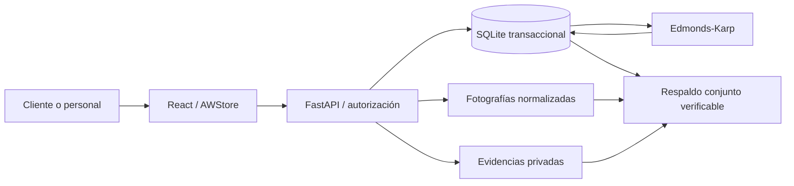
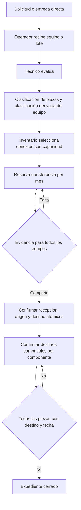

# AWStore: arquitectura y transición

## Contexto y alcance

AWStore es una organización ficticia en Quito que comercializa tecnología y recupera equipos usados. Este caso académico usa datos sintéticos. El AS-IS es un escenario de estudio, no un diagnóstico obtenido mediante entrevistas a una empresa real.

Objetivos: unificar ventas e inventario, impedir descuentos duplicados de stock, mantener responsables y evidencias de los equipos recuperados y analizar la capacidad de una red circular. La identidad comercial AWStore es independiente del nombre técnico EcoRAEE utilizado por variables de entorno, cookies e identificadores anteriores.

Capacidades: comercio, atención, crédito, gestión de usuarios, recepción, diagnóstico, reacondicionamiento, clasificación, logística circular, auditoría y análisis de capacidad.

## AS-IS del escenario

El negocio recibe equipos mediante fichas separadas; ventas consulta existencias por mensajes; el taller guarda diagnósticos sin una relación única con la recepción; inventario registra destinos en hojas independientes. No existe un análisis común de la capacidad de centros ni un responsable identificable de cada cambio. Consecuencias previstas: duplicados, sobreventa, pérdida de evidencias y rutas sin comprobación de capacidad.

## TO-BE local implementado

- Negocio: cuenta por persona, rol administrado, registro individual o por lotes, evaluación técnica y transferencias con confirmación.
- Información: SQLite centraliza relaciones, estados, inventarios, pagos, centros, capacidades, eventos y escenarios. Las fotos y evidencias se guardan fuera del código y se respaldan junto a la base.
- Aplicaciones: React consume una API FastAPI. Los roles se validan en el servidor, también si alguien llama la API directamente. El algoritmo recibe nodos y aristas desde SQL.
- Tecnología: ejecución local Windows, Python, Node.js, Vite y almacenamiento local. No hay recursos AWS desplegados.

## Procesos

El archivo `proceso.bpmn` contiene un proceso BPMN 2.0 editable. Es un modelo de colaboración académica simplificado; no es un motor BPMN en ejecución. Los diagramas Mermaid son complementarios, no se presentan como sustitutos de BPMN.

## Marco de referencia

Se aplica un ciclo simplificado de TOGAF ADM: visión y capacidades (A), procesos y responsables (B), entidades e interfaces (C), arquitectura local y objetivo cloud (D), brechas y transición (E/F), revisiones de pruebas y cambios (G/H). Esta adaptación organiza los entregables; no implica certificación TOGAF.

| Brecha | Cambio aplicado o pendiente | Criterio de cierre |
|---|---|---|
| Registros separados | Códigos únicos y relaciones SQL | Integridad y ciclo completo probados |
| Roles seleccionables | Login único; rol leído de la base | Login por cada rol y denegación de accesos |
| Evidencias dispersas | Archivos privados y respaldo conjunto | Recuperación de base y archivos |
| Destinos sin validación | Tipos compatibles y restricciones SQL | Rechazo de beneficiario para no recuperable |
| Capacidad desconocida | Centros, conexiones y algoritmo | Coincidencia flujo/corte y escenarios |
| Dependencia de una computadora | Pendiente AWS y RDS | Pruebas cloud reales, autorizadas posteriormente |
| Validación social inicial | Análisis de escenario y cambios de diseño | Pendiente prueba con participantes y revisión docente |

## Gobierno y responsabilidades

ARB propuesto: responsable de negocio, responsable técnico, responsable de datos y responsable de impacto social. No se asignan nombres ficticios ni se afirma que exista un acta celebrada.

Toda revisión registra: requisito afectado, alternativa, motivo, impacto en datos y permisos, prueba, riesgo residual, responsable y decisión. Cambios de roles requieren administración; ampliaciones de capacidad requieren revisión logística. El docente o equipo confirma las decisiones académicas y las excepciones antes de la entrega.

Decisiones locales: mantener PK y FK al cambiar marca; usar migraciones aditivas; guardar importes en centavos; fotos opcionales y privadas por recurso; preservar las cuentas existentes; comparar escenarios matemáticos sin alterar capacidades operativas.

## Hoja de ruta

1. Validación local: regresión comercial, fotos, seguridad, lotes, transferencias, recuperación y modelo matemático.
2. Revisión académica: completar evidencias humanas, ajustar BPMN/EER y verificar matriz de requisitos con docentes.
3. AWS, solo tras instrucción del usuario: adaptar persistencia a PostgreSQL/RDS, objetos S3, HTTPS, secretos, VPC e infraestructura reproducible.
4. Validación cloud: red e IAM, alarmas, costos, recuperación y demostración accesible. Una ejecución local no cierra esta fase.
