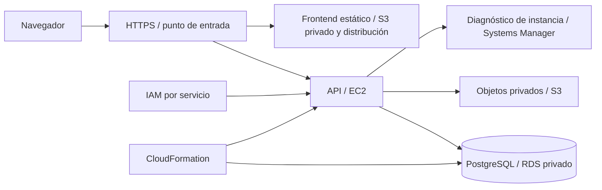

# Despliegue de EcoRAEE en AWS

El alcance académico usa solamente datos de demostración. La plantilla `storage.aws.json` define dos buckets privados y un perfil de instancia EC2 con acceso limitado al prefijo `evidence/`. El backend selecciona S3 para evidencias cuando se configura `ECORAEE_EVIDENCE_BUCKET` y usa las credenciales temporales del rol de EC2. Las instalaciones locales conservan su directorio de evidencias.

## Arquitectura de la demostración

## Plantillas y operación

- `storage.aws.json` crea el almacenamiento privado. La carpeta pública del sitio se sirve mediante CloudFront con una política de origen de solo lectura sobre `site/`.
- `compute.aws.json` configura un servidor EC2 `t4g.micro` y un RDS PostgreSQL privado `db.t4g.micro` con 20 GiB. La API conecta con TLS validado. No requiere NAT Gateway, balanceador ni puertos SSH. El ZIP de despliegue incluye `backend/app`, los requisitos de Python, `database/` y `frontend/src/utilidades/caracteristicasProducto.json`.
- `site.aws.json` define la distribución HTTPS. Las rutas `/api/*` y `/uploads/*` se dirigen a EC2 sin caché.
- `team.aws.json` define dos identidades de ejemplo, sus grupos y sus políticas de proyecto. Se crean sin contraseñas de consola ni claves de acceso.
- `bootstrap_postgres` genera una base local temporal con datos sintéticos y conserva sus identificadores, relaciones, vistas y transiciones en PostgreSQL. Los archivos y la base de datos del trabajo local quedan fuera del paquete.

Para la grabación, verifica primero `/api/health` y el CRUD del sitio. Después registra un equipo y adjunta evidencia, muestra el objeto privado en S3 y abre la evidencia desde la aplicación. Muestra la instancia EC2, el RDS privado y los roles y grupos IAM. Cada integrante debe explicar su aporte dentro del límite de cinco minutos.

Las claves temporales de los roles de la aplicación están en el parámetro cifrado `/ecoraee-demo/app-logins` de Systems Manager, en `us-east-1`. Mantén el valor oculto durante la grabación.

Al terminar la grabación, elimina la distribución y el origen antes del stack de cómputo. Después elimina las identidades temporales y el parámetro cifrado. El stack de almacenamiento conserva los buckets al borrarse. Para retirar el almacenamiento de la demostración, borra las versiones de sus objetos y elimina ambos buckets. Confirma en CloudFormation y en las consolas EC2 y RDS que la limpieza terminó.

## Referencias técnicas para esa fase

- [CloudFormation: DBInstance y contraseña administrada](https://docs.aws.amazon.com/AWSCloudFormation/latest/TemplateReference/aws-resource-rds-dbinstance.html)
- [CloudFormation: bloqueo de acceso público S3](https://docs.aws.amazon.com/AWSCloudFormation/latest/TemplateReference/aws-properties-s3-bucket-publicaccessblockconfiguration.html)

